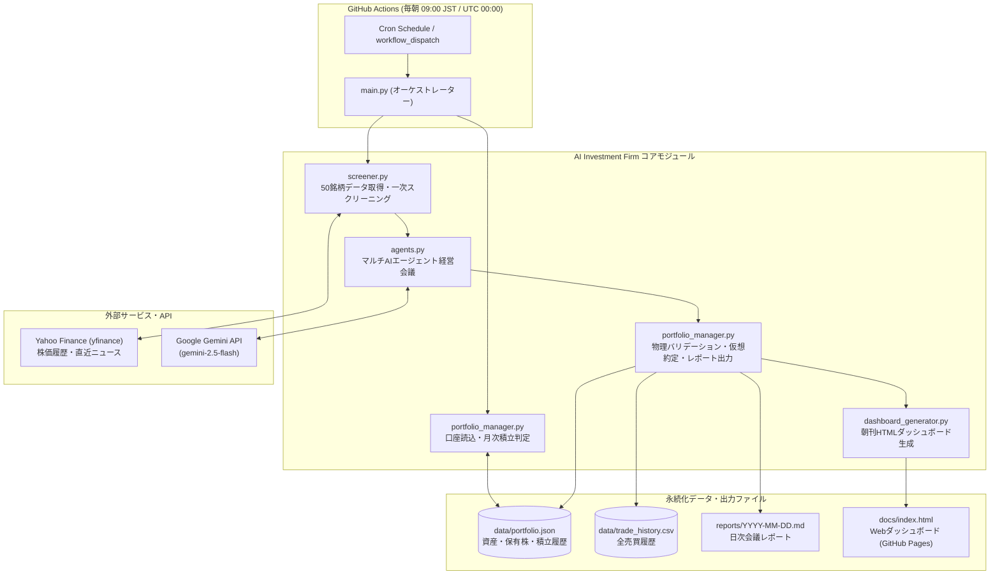
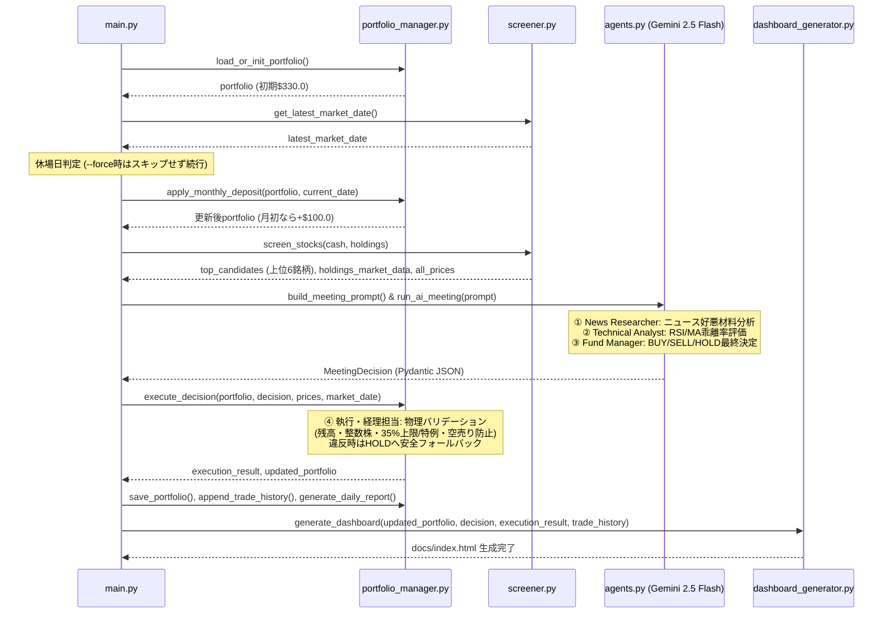

# 基本設計書（02_basic_design.md）

## 1. システム全体構成図

本システムはローカル環境（`.venv`）およびGitHub Actions上で動作するバッチアプリケーションであり、生成された静的ファイルをGitHub Pagesで公開するアーキテクチャを採用する。

---

## 2. モジュール構成と役割分担

| ファイル名 | 役割・責務 |
| :--- | :--- |
| `main.py` | コマンドライン引数（`--force`, `--proposal-only`, `--instruction`, `--analysis-only`）の解析、環境変数（`.env`）の読込、モジュールホットリロード（`importlib.reload`）、全体ワークフローの順次実行制御を行う。 |
| `server.py` | ローカル双方向Webサーバー（`http://127.0.0.1:8000`）を起動し、画面からの即時会議招集（`POST /api/meeting`）や単一・複数銘柄の一括売買報告（`POST /api/manual_trade`）を受け付け、Origin検証・リクエストサイズ制限・入力バリデーションを実施する。 |
| `start_dashboard.command` | macOSのFinderからダブルクリック1回で `server.py` を起動し、ブラウザで `http://127.0.0.1:8000` を開くランチャースクリプト。 |
| `screener.py` | 厳選50銘柄（11セクター45社＋ETF 5銘柄）の定義、最新取引日チェック、株価・出来高データの取得、テクニカル指標計算、上位6銘柄の抽出、直近ニュースの安全な取得を行う。 |
| `agents.py` | 上位6銘柄＋保有銘柄の情報からプロンプトを構築し、`google-genai` SDKで `gemini-2.5-flash` を呼び出し、Pydanticモデル `MeetingDecision`（副案リスト `additional_proposals: list[SubOrderProposal]` を含む）で構造化された会議結果を取得する。 |
| `portfolio_manager.py` | `data/portfolio.json` の初期化・読込、月次積立（`+$100.0`）の判定・実行、AI決定の物理バリデーションまたは提案専用モード（`proposal_only=True`）、手動売買・入金報告の即時記帳、CSV数式インジェクション無害化付きの `data/trade_history.csv`（実行済み取引のみ記録）および `reports/YYYY-MM-DD.md` の保存を行う。 |
| `dashboard_generator.py` | 完全日本語化された朝刊ダッシュボード＆社長室HTMLを `docs/index.html` に生成する。ドラクエ風16×16ドット絵SVGキャラ4体、好調/普通/不調バッジ、フルスクリーンローディングモーダル、複数株ステッパー、複数銘柄まとめカート、実行時の口座状況付き売買履歴テーブルを描画する。 |

---

## 3. マルチAIエージェント連携フロー

---

## 4. 画面設計（朝刊ダッシュボード `docs/index.html`）

PCおよびスマートフォンの双方で視認性の高い、モダンな金融ダッシュボードUIを構築する。

### 4.1 レイアウト構成
1. **ナビゲーション＆サマリーヘッダー（完全日本語表記）**
   - タイトル：「AI投資会社 — 朝刊ダッシュボード＆社長室」と最終更新日時、米国市場の基準日。
   - KPIカード4枚（レスポンシブグリッド）：
     - **全体の資産額**: ドル表記（`$XXX.XX`）＋円換算目安（`@150円/USD` 換算表記）
     - **トータルの損益**: 累計入金額に対する損益額（`+$XX.XX` / `-$XX.XX`）と損益率（`+X.XX%`）
     - **使える現金（買付余力）**: ドル表記＋全体の資産に対する現金の割合
     - **これまでに入金した元本**: 初期資金 `$330.0` ＋ 月次積立累計額および保有銘柄数
2. **本日のAI提案＆社長の決定カード（最上部・強調表示）**
   - アクションバッジ：`株を買う提案 (BUY)`、`株を売る提案 (SELL)`、`今回は様子見 (HOLD)`
   - **複数株変更ステッパー＆ワンクリック決定ボタン**：`[-]` `[+]` ボタンで株数を自由に変更可能。またAIが複数銘柄を提案した場合（`additional_proposals`）はチェックボックスで複数銘柄を選んで「チェックした銘柄をまとめて決定」ボタンで一括反映可能。
   - **SBI証券 スマホ注文の手順ガイド**：外貨建/円貨建、ティッカー入力、株数、成行/指値の目安など、そのままスマホで注文できる具体的手順を表示。
3. **オーナー（社長）指令室 ＆ 決定・報告パネル**
   - **左側（AI社員に今すぐ分析・会議を命令する）**：ワンクリック指示タグ、自由入力欄、会議招集ボタン（押下時はフルスクリーン・ローディングモーダルと4人のRPGキャラ進捗を表示）。
   - **右側（社長の「これを買った／売った」決定・報告）**：AI提案銘柄・保有銘柄のワンクリック選択チップ、全55銘柄の日本語名付きプルダウン、`[-]` `[+]` `最大` 株数ボタン、リアルタイム金額・残り現金プレビュー、さらに複数銘柄をカートに溜めて一括反映できる「＋ 複数銘柄まとめリストに追加」機能を搭載。
4. **AI社員4人の経営会議ルーム（ドラクエ風ドット絵人形＆好調・普通・不調ステータス）**
   - 4人のAI社員それぞれに16×16ドット絵SVG人形アイコン（情報屋・大賢者・勇者リーダー・金庫番パラディン）、一目で状況がわかる調子バッジ（`🌞 好調！` / `⛅ 普通` / `🌧️ 不調…`）、テンションゲージ（`%`）、および「💡 つまり一言でいうと」の1行要約を表示。
5. **ポートフォリオ＆チャートセクション**
   - **現在保有している株の一覧テーブル**: 銘柄名（日本語併記）、業種・ジャンル（日本語）、保有株数、買った時の平均価格、今の株価、現在の価値、損益（`$` / `%`）、資産に占める割合（`%`）
   - **業種・ジャンル別の割合ドーナツグラフ（Chart.js）**: 各業種（日本語表記）の評価額＋使える現金の比率を可視化
   - **資産の推移グラフ（Chart.js）**: 日次の資産合計額と入金した元本の推移を比較表示
6. **実際に実行した売買・入金の履歴（実行時の口座状況）テーブル**
   - 提案のみ（`HOLD` / `0株`）の会議ログは除外し、実際に社長が決定・実行した `BUY` / `SELL` / `DEPOSIT` のみを表示。
   - 各行に「実行日」「やったこと」「銘柄名・業種」「株数 × 単価」「動いたお金（ドル・円）」「実行直後の口座状況（💵 残り現金 ／ 🏢 株合計 ／ 💰 総資産）」「内容メモ」を見出し改行なし（`whitespace-nowrap`）で表示。

---

## 5. 外部API・ライブラリ連携仕様

### 5.1 Yahoo Finance (`yfinance`)
- **株価取得**: `yf.Ticker(ticker).history(period="3mo")` を基本とし、万一 `MultiIndex` カラムが返却された場合は `df.columns = df.columns.get_level_values(0)` でフラット化する。
- **ニュース取得**: 上位候補銘柄および保有銘柄についてのみ `yf.Ticker(ticker).news` を取得し、`item.get("title") or item.get("content", {}).get("title", "")` でタイトルを抽出する。
- **エラーハンドリング**: 個別銘柄の通信エラーやデータ欠損（25営業日未満）は `try-except` で捕捉し、ログ出力の上で当該銘柄をスキップして処理を継続する。全銘柄が取得失敗した場合でもフォールバック株価データで安全に `HOLD` 処理へ移行できるようにする。

### 5.2 Google Gemini API (`google-genai`)
- **使用パッケージ**: `google-genai`（`from google import genai`, `from google.genai import types`）
- **使用モデル**: `gemini-2.5-flash`
- **構造化出力設定**:
  - `response_mime_type="application/json"`
  - `response_schema=MeetingDecision`
  - `temperature=0.2`
- **フォールバック仕様**:
  - 環境変数 `GEMINI_API_KEY` が未設定、空文字、`"your_api_key_here"` または `"your_gemini_api_key_here"` の場合、APIを呼び出さずにモックの `MeetingDecision(action="HOLD", ...)` を返却する。
  - API呼び出し時にネットワーク例外やクォータ制限エラーが発生した場合も例外をキャッチし、安全な `HOLD` の `MeetingDecision` を返却する。
