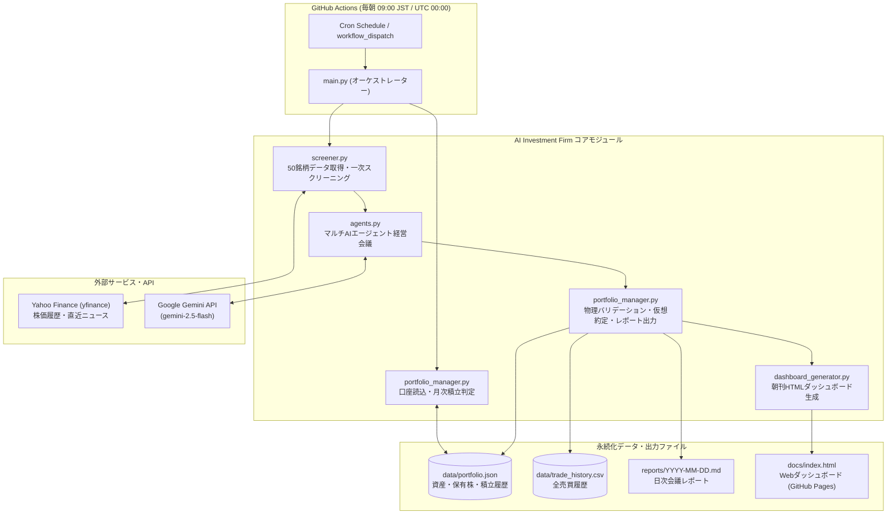
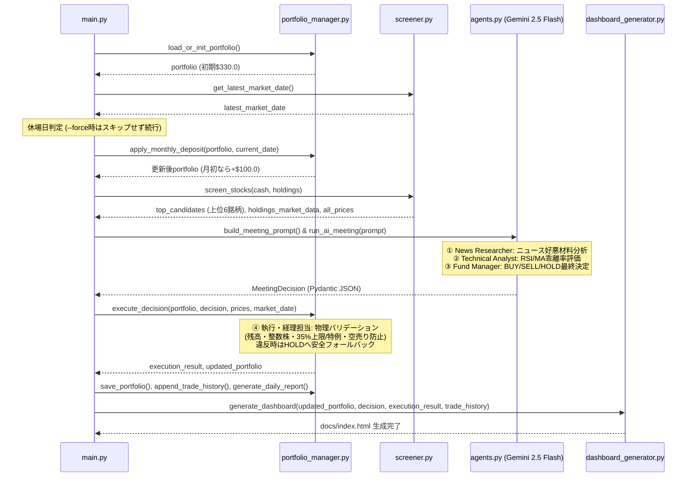

# 基本設計書（02_basic_design.md）

## 1. システム全体構成図

本システムはローカル環境（`.venv`）およびGitHub Actions上で動作するバッチアプリケーションであり、生成された静的ファイルをGitHub Pagesで公開するアーキテクチャを採用する。

---

## 2. モジュール構成と役割分担

| ファイル名 | 役割・責務 |
| :--- | :--- |
| `main.py` | コマンドライン引数（`--force`）の解析、環境変数（`.env`）の読込、全体ワークフローの順次実行制御を行う。 |
| `screener.py` | 厳選50銘柄（11セクター45社＋ETF 5銘柄）の定義、最新取引日チェック、株価・出来高データの取得、テクニカル指標計算、上位6銘柄の抽出、直近ニュースの安全な取得を行う。 |
| `agents.py` | 上位6銘柄＋保有銘柄の情報からプロンプトを構築し、`google-genai` SDKで `gemini-2.5-flash` を呼び出し、Pydanticモデル `MeetingDecision` で構造化された会議結果を取得する。 |
| `portfolio_manager.py` | `data/portfolio.json` の初期化・読込、月次積立（`+$100.0`）の判定・実行、AI決定の物理バリデーション（残高・整数株・35%上限＋初期特例・保有株数）、約定処理、`data/trade_history.csv` および `reports/YYYY-MM-DD.md` の保存を行う。 |
| `dashboard_generator.py` | 最新のポートフォリオ状態、会議結果、売買履歴をもとに、Tailwind CSS＋Chart.jsを用いたレスポンシブ単一HTMLを `docs/index.html` に出力する。 |

---

## 3. マルチAIエージェント連携フロー

---

## 4. 画面設計（朝刊ダッシュボード `docs/index.html`）

PCおよびスマートフォンの双方で視認性の高い、モダンな金融ダッシュボードUIを構築する。

### 4.1 レイアウト構成
1. **ナビゲーション＆サマリーヘッダー**
   - タイトル：「AI Investment Firm - Morning Brief Dashboard」と最終更新日時、対象市場取引日。
   - KPIカード4枚（レスポンシブグリッド）：
     - **総資産額（Total Equity）**: ドル表記（`$XXX.XX`）＋円換算目安（`@150円/USD` 換算表記）
     - **トータル損益（Total Return）**: 累計入金額に対する損益額（`+$XX.XX` / `-$XX.XX`）と損益率（`+X.XX%`）
     - **現在の現金残高（Buying Power / Cash）**: ドル表記＋総資産に対するキャッシュ比率
     - **累計入金額（Total Invested Capital）**: 初期資金 `$330.0` ＋ 月次積立累計額および保有銘柄数
2. **本日の最終結論カード（最上部・強調表示）**
   - アクションバッジ：`BUY`（エメラルドグリーン）、`SELL`（ローズレッド）、`HOLD`（スレートグレー）
   - 注文サマリー：対象ティッカー、セクター、売買株数（整数株）、参考終値、概算約定金額、執行ステータス（約定完了 / 現金温存 / バリデーションによるHOLD変更）
   - **SBI証券 手動注文ガイドボックス**：外貨建/円貨建、ティッカー入力、株数、成行/指値の目安など、そのままスマホで注文できる具体的手順を表示。
3. **4体のAI社員の経営会議ルーム（チャット吹き出し形式）**
   - **① 情報収集担当（News Researcher）**: 青色バッジ・ニュースアイコン付き吹き出し
   - **② テクニカル分析担当（Technical Analyst）**: 紫色バッジ・チャートアイコン付き吹き出し
   - **③ ファンドマネージャー（Fund Manager）**: 琥珀色バッジ・王冠アイコン付き吹き出し
   - **④ 執行・経理担当（Execution & Accounting）**: 緑色バッジ・盾アイコン付き吹き出し（物理バリデーション結果と最終記帳報告）
4. **ポートフォリオ＆チャートセクション**
   - **保有銘柄一覧テーブル**: ティッカー、セクター、保有株数、平均取得単価、現在株価、評価額、評価損益（`$` / `%`）、総資産構成比（`%`）
   - **セクター構成比ドーナツグラフ（Chart.js）**: 各セクターの評価額＋現金（Cash）の比率を可視化
   - **総資産推移折れ線グラフ（Chart.js）**: 日次の総資産額（Total Equity）と累計入金額（Invested Capital）の推移を比較表示
5. **直近売買履歴一覧テーブル**
   - `data/trade_history.csv` から日時、アクション、ティッカー、セクター、株数、約定単価、約定金額、取引後現金残高、備考を表示。

---

## 5. 外部API・ライブラリ連携仕様

### 5.1 Yahoo Finance (`yfinance`)
- **株価取得**: `yf.Ticker(ticker).history(period="3mo")` を基本とし、万一 `MultiIndex` カラムが返却された場合は `df.columns = df.columns.get_level_values(0)` でフラット化する。
- **ニュース取得**: 上位候補銘柄および保有銘柄についてのみ `yf.Ticker(ticker).news` を取得し、`item.get("title") or item.get("content", {}).get("title", "")` でタイトルを抽出する。
- **エラーハンドリング**: 個別銘柄の通信エラーやデータ欠損（25営業日未満）は `try-except` で捕捉し、ログ出力の上で当該銘柄をスキップして処理を継続する。全銘柄が取得失敗した場合でもフォールバック株価データで安全に `HOLD` 処理へ移行できるようにする。

### 5.2 Google Gemini API (`google-genai`)
- **使用パッケージ**: `google-genai`（`from google import genai`, `from google.genai import types`）
- **使用モデル**: `gemini-2.5-flash`
- **構造化出力設定**:
  - `response_mime_type="application/json"`
  - `response_schema=MeetingDecision`
  - `temperature=0.2`
- **フォールバック仕様**:
  - 環境変数 `GEMINI_API_KEY` が未設定、空文字、`"your_api_key_here"` または `"your_gemini_api_key_here"` の場合、APIを呼び出さずにモックの `MeetingDecision(action="HOLD", ...)` を返却する。
  - API呼び出し時にネットワーク例外やクォータ制限エラーが発生した場合も例外をキャッチし、安全な `HOLD` の `MeetingDecision` を返却する。
