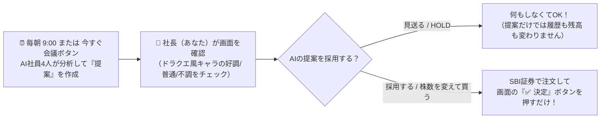

# 使い方・画面の見方ガイド（07_user_manual.md）

このドキュメントでは、「どこを開けばいいか」「毎朝どこを見ればいいか」「SBI証券でどう注文するか」を初心者向けに図解付きで解説します。

---

## 1. 結論：AIは「提案」するだけ！最終決定ボタンを押すのはあなた（社長）です

このシステムは **毎日 朝9:00（日本時間）** に自動で動き、米国市場の終値とニュースを分析して「今日買うべき株・売るべき株・見送り（HOLD）」の**方針提案**を作成します。
**AIが勝手に口座データを書き換えることはありません。** あなたが画面を見て、納得したときだけ「✅ 決定」ボタンを押して反映します。



---

## 2. どこを開いて確認するの？（3つの方法）

あなたの環境（Privateリポジトリ運用・PC/スマホ）に合わせて、一番見やすい方法で確認できます。

### 方法A：【一番おすすめ・命令＆売買報告もできる！】社長室ダッシュボードを開く
プロジェクトの中の **`start_dashboard.command`** を開くと、グラフ付きの画面が開き、さらに**画面上のボタンから「今すぐ分析して！」の命令や「実際に買った／売った」の報告**がその場でできます。

- **開き方（2通り）**:
  1. **Finder（フォルダ）からダブルクリックで開く（一番簡単！）**:
     Macの「Finder」で `/Users/kasaiyuma/AI/ai-investment-firm/` フォルダを開き、**`start_dashboard.command` をダブルクリック**すると、自動でブラウザ（`http://127.0.0.1:8000`）が開きます。
  2. **ターミナルで開く**:
     ```bash
     cd /Users/kasaiyuma/AI/ai-investment-firm && .venv/bin/python server.py
     ```
  *(※見るだけなら `/Users/kasaiyuma/AI/ai-investment-firm/docs/index.html` を直接開いても見られます)*

---

### 方法B：【外出先・スマホから見る】GitHubで毎朝のレポートを読む
リポジトリを **Private（非公開）** のままにしている場合でも、スマホやPCから以下のURL（GitHub）を開けば、毎朝の会議レポートがそのまま読めます。

1. **GitHubのリポジトリページを開く**:
   https://github.com/nexobam/ai-investment-firm
2. **`reports` フォルダをタップする**:
   - 中に **`2026-11-14.md`** のように「その日の日付」のファイルが毎日自動で作られます。
   - 一番新しい日付のファイルをタップすると、**「本日の結論」「SBI証券の注文ガイド」「4人のAI社員の会議ログ」「保有株一覧」** が綺麗な表で表示されます。

> 💡 **スマホにもっと便利に見るコツ**
> iPhone / Android に無料の **「GitHub公式アプリ」** を入れてログインしておくと、毎朝ワンタップで `reports/` の最新レポートが読めます。
> （もし今後リポジトリを Public に変更した場合は、`https://nexobam.github.io/ai-investment-firm/` という専用WebサイトURLからスマホでも方法Aのグラフ画面が見られるようになります）

---

### 方法C：【ExcelやNumbersで見る】売買履歴CSVを開く
過去のすべての取引履歴は Excel で開ける CSV ファイルに自動記録されています。

- **ファイルの場所**:
  `/Users/kasaiyuma/AI/ai-investment-firm/data/trade_history.csv`

---

## 3. 朝刊ダッシュボード画面（`docs/index.html`）の見方

`docs/index.html` をブラウザで開くと、上から順番に以下の5つのエリアが表示されます。

```text
+-------------------------------------------------------------------------+
| 🟢 AI Investment Firm Morning Brief             対象取引日: 2026-11-13  |
+-----------------+-----------------+-----------------+-------------------+
| ① 総資産額      | ② トータル損益  | ③ 現在の現金残高| ④ 保有株評価額    |
|   $330.00       |   +$0.00 (+0%)  |   $167.15       |   $162.85 (1銘柄) |
|  (約 ¥49,500)   | (元本 $330.00)  |  (約 ¥25,072)   |  最終積立:2026-11 |
+-----------------+-----------------+-----------------+-------------------+
| 👑 オーナー（社長）指令室 ＆ 実売買報告パネル                           |
|  [左] 🗣️ AI社員に「今すぐ分析・会議」を命令する（ボタン1つで即実行！）  |
|  [右] 📝「実際に買った／売った／入金した」を報告する（ポートフォリオ反映）|
+-------------------------------------------------------------------------+
| ★一番重要！【本日のAI経営会議 最終結論カード】                          |
|  [ BUY（現物買付） ]   対象: NVDA  |  株数: 1株  |  株価: $162.85       |
|  ┌-------------------------------------------------------------------┐  |
|  | 📱 SBI証券（米国株アプリ/Web）手動注文操作ガイド                  |  |
|  | 「銘柄検索で NVDA を選択 → 買付 → 1株 → 成行 → 特定/NISAで発注」  |  |
|  └-------------------------------------------------------------------┘  |
+-------------------------------------------------------------------------+
| 💬 AI社員の朝刊経営会議ルーム（なぜその結論になったかの理由）           |
|  📰 情報収集担当 (News Researcher)     : ニュースの好材料・悪材料の解説 |
|  📊 テクニカル分析担当 (Analyst)       : RSIや移動平均線からの買い時診断|
|  👑 ファンドマネージャー (Fund Manager): 資金配分を踏まえた最終決断理由 |
|  🛡️ 執行・経理担当 (Accounting)        : 35%ルールや残高チェック結果    |
+-----------------------------------+-------------------------------------+
| 🍩 セクター構成比ドーナツグラフ   | 📈 総資産推移 vs 累計入金額グラフ   |
+-----------------------------------+-------------------------------------+
| 📋 保有銘柄一覧テーブル（現在持っている株・取得単価・含み損益）         |
+-------------------------------------------------------------------------+
| 🕒 直近売買・執行履歴テーブル（いつ・何を・いくらで売買したか）         |
+-------------------------------------------------------------------------+
```

### 各パーツのチェックポイント

#### ① 最上部の4つの数字（現在の成績表）
- **総資産額 (Total Equity)**: 「現金 ＋ 持っている株の時価」の合計です（スタート時は `$330.00` ≒ 約49,500円）。
- **トータル損益 (Total Return)**: あなたが投入した累計元本に対して、現在いくらプラス（緑色）かマイナス（赤色）かを表示します。
- **現在の現金残高 (Cash)**: 次に株を買うために使える余力（ドル）です。毎月1日（月初の初回稼働日）に自動で `+$100.00`（約15,000円）が加算されます。
- **保有株評価額**: いま持っている米国株の合計価値です。

#### ② 本日のAI提案＆社長の決定カード（★1株だけでなく複数株・複数銘柄も一括OK！）
バッジの色で「今日のAI提案」が一目で分かります：
- 🟢 **`株を買う提案 (BUY)`（緑色）**: 買い提案です。`[-]` `[+]` ボタンで株数を自由に変更して **「✅ このAI提案を決定」** ボタンを押せば口座データへ即反映されます。
- 📦 **複数銘柄の同時提案リスト**: AIが複数銘柄の分散買付を提案した場合は、チェックボックスで好きな銘柄・株数を選んで **「✅ チェックした銘柄をまとめて決定」** ボタンで一括反映できます。
- 🔴 **`株を売る提案 (SELL)`（赤色）**: 売り（利益確定または損切り）提案です。
- ⚪ **`今回は様子見 (HOLD)`（グレー）**: 「今日は無理に買わず現金を温存する日」です。

#### ③ オーナー（社長）指令室の「まとめリスト（カート）」で複数売買もラクラク
右側の「2. 社長の『これを買った／売った』決定・報告」パネルでは：
- **ワンクリック銘柄チップ**（AI提案銘柄・現在保有中の銘柄）または **全55銘柄の日本語名付きプルダウン** から選ぶだけで、現在株価と「合計いくら・残り現金いくら・最大何株買えるか」がリアルタイムに自動計算されます。
- 1度に複数の株を売買した場合は **「＋ 複数銘柄まとめリストに追加」** を押していくことで、複数銘柄を1クリックでまとめて口座へ反映できます。

#### ④ ドラクエ風ドット絵AI社員4人の経営会議ルーム
難しい専門用語を読まなくても、4人の可愛いドット絵キャラクターの横にあるバッジを見るだけで状況が分かります：
- **🌞 好調！（緑）** ／ **⛅ 普通（黄）** ／ **🌧️ 不調…（赤）** の3段階アイコンと **テンションゲージ（%）** を表示。
- 各キャラクターの吹き出しの一番上に **「💡 つまり一言でいうと：〇〇」** の要約が太字で表示されます。
  - **🕵️ 情報屋（ニュース担当）**: 世界の経済ニュースの追い風・向かい風を報告
  - **🧙‍♂️ 大賢者（チャート分析担当）**: お買い得度（RSIなど）を計算
  - **⚔️ 勇者リーダー（運用責任者）**: どの株を何株買うかの最終提案を作成
  - **🛡️ 金庫番パラディン（経理・リスク管理）**: 予算オーバーやルール違反がないかチェック

#### ⑤ 実際に実行した売買・入金の履歴（実行時の口座状況）
- **提案だけ（見送り・未決定）の会議は履歴に入りません。** あなたが実際に「決定」ボタンを押して実行した売買・入金だけが記録されます。
- 各行に **「実行直後の口座状況（💵 残り現金 ／ 🏢 株合計 ／ 💰 総資産）」** が並んで表示されるため、その取引をした時に資産がどう動いたかが一目で分かります。

---

## 4. よくある操作・コマンド集（Macで使うとき）

普段は GitHub が毎朝9:00に自動で動かしてくれますが、自分のMac（手元）でも操作したい場合は以下のコマンドをターミナルに貼り付けるだけです。

### ① 自分のMacで今すぐ最新のダッシュボード画面（`docs/index.html`）を開く
```bash
open /Users/kasaiyuma/AI/ai-investment-firm/docs/index.html
```

### ② GitHubが毎朝自動更新した最新データを自分のMacに取り込む（同期する）
```bash
cd /Users/kasaiyuma/AI/ai-investment-firm && git pull
```

### ③ 自分のMacで今すぐAI経営会議を強制実行してみる
（米国市場が休みの土日でもテスト実行したい場合）
```bash
cd /Users/kasaiyuma/AI/ai-investment-firm && .venv/bin/python main.py --force
```

---

## 5. GitHub上で「ちゃんと毎日動いているか」確認する場所

1. ブラウザで https://github.com/nexobam/ai-investment-firm を開きます。
2. 上のメニューの **「▶️ Actions」** をクリックします。
3. **「Daily AI Investment Meeting」** の履歴一覧が表示されます。
   - 緑色のチェックマーク **✅** が付いていれば、その日の朝9:00のAI会議が正常に完了しています。
   - もし今すぐGitHub上でテスト実行したい場合は、右側の **「Run workflow」** ボタン → `true` を選んで **「Run workflow」** を押せば、いつでも手動で動かせます。
