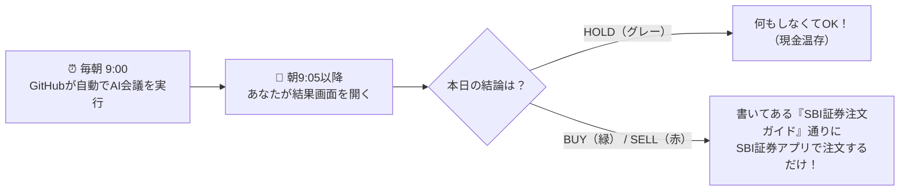

# 使い方・画面の見方ガイド（07_user_manual.md）

このドキュメントでは、「どこを開けばいいか」「毎朝どこを見ればいいか」「SBI証券でどう注文するか」を初心者向けに図解付きで解説します。

---

## 1. 結論：毎朝やることは「1つ」だけ！

このシステムは **毎日 朝9:00（日本時間）** に自動で動き、米国市場の終値とニュースを分析して「今日買うべき株・売るべき株・見送り（HOLD）」を決定します。



---

## 2. どこを開いて確認するの？（3つの方法）

あなたの環境（Privateリポジトリ運用・PC/スマホ）に合わせて、一番見やすい方法で確認できます。

### 方法A：【一番おすすめ・グラフ付き】PCで朝刊ダッシュボード画面を開く
プロジェクトの中の **`docs/index.html`** が「朝刊ダッシュボード（Web画面）」です。

- **ファイルがある場所**:
  `/Users/kasaiyuma/AI/ai-investment-firm/docs/index.html`
- **開き方（2通り）**:
  1. **Finder（フォルダ）から開く**:
     Macの「Finder」で `/Users/kasaiyuma/AI/ai-investment-firm/docs/` フォルダを開き、**`index.html` をダブルクリック**すると、ChromeやSafariでグラフ付きの綺麗な画面が開きます。
  2. **ターミナルで1行打って開く**:
     ```bash
     open /Users/kasaiyuma/AI/ai-investment-firm/docs/index.html
     ```

---

### 方法B：【外出先・スマホから見る】GitHubで毎朝のレポートを読む
リポジトリを **Private（非公開）** のままにしている場合でも、スマホやPCから以下のURL（GitHub）を開けば、毎朝の会議レポートがそのまま読めます。

1. **GitHubのリポジトリページを開く**:
   https://github.com/nexobam/ai-investment-firm
2. **`reports` フォルダをタップする**:
   - 中に **`2026-11-14.md`** のように「その日の日付」のファイルが毎日自動で作られます。
   - 一番新しい日付のファイルをタップすると、**「本日の結論」「SBI証券の注文ガイド」「4人のAI社員の会議ログ」「保有株一覧」** が綺麗な表で表示されます。

> 💡 **スマホにもっと便利に見るコツ**
> iPhone / Android に無料の **「GitHub公式アプリ」** を入れてログインしておくと、毎朝ワンタップで `reports/` の最新レポートが読めます。
> （もし今後リポジトリを Public に変更した場合は、`https://nexobam.github.io/ai-investment-firm/` という専用WebサイトURLからスマホでも方法Aのグラフ画面が見られるようになります）

---

### 方法C：【ExcelやNumbersで見る】売買履歴CSVを開く
過去のすべての取引履歴は Excel で開ける CSV ファイルに自動記録されています。

- **ファイルの場所**:
  `/Users/kasaiyuma/AI/ai-investment-firm/data/trade_history.csv`

---

## 3. 朝刊ダッシュボード画面（`docs/index.html`）の見方

`docs/index.html` をブラウザで開くと、上から順番に以下の5つのエリアが表示されます。

```text
+-------------------------------------------------------------------------+
| 🟢 AI Investment Firm Morning Brief             対象取引日: 2026-11-13  |
+-----------------+-----------------+-----------------+-------------------+
| ① 総資産額      | ② トータル損益  | ③ 現在の現金残高| ④ 保有株評価額    |
|   $330.00       |   +$0.00 (+0%)  |   $167.15       |   $162.85 (1銘柄) |
|  (約 ¥49,500)   | (元本 $330.00)  |  (約 ¥25,072)   |  最終積立:2026-11 |
+-----------------+-----------------+-----------------+-------------------+
| ★一番重要！【本日のAI経営会議 最終結論カード】                          |
|  [ BUY（現物買付） ]   対象: NVDA  |  株数: 1株  |  株価: $162.85       |
|  ┌-------------------------------------------------------------------┐  |
|  | 📱 SBI証券（米国株アプリ/Web）手動注文操作ガイド                  |  |
|  | 「銘柄検索で NVDA を選択 → 買付 → 1株 → 成行 → 特定/NISAで発注」  |  |
|  └-------------------------------------------------------------------┘  |
+-------------------------------------------------------------------------+
| 💬 AI社員の朝刊経営会議ルーム（なぜその結論になったかの理由）           |
|  📰 情報収集担当 (News Researcher)     : ニュースの好材料・悪材料の解説 |
|  📊 テクニカル分析担当 (Analyst)       : RSIや移動平均線からの買い時診断|
|  👑 ファンドマネージャー (Fund Manager): 資金配分を踏まえた最終決断理由 |
|  🛡️ 執行・経理担当 (Accounting)        : 35%ルールや残高チェック結果    |
+-----------------------------------+-------------------------------------+
| 🍩 セクター構成比ドーナツグラフ   | 📈 総資産推移 vs 累計入金額グラフ   |
+-----------------------------------+-------------------------------------+
| 📋 保有銘柄一覧テーブル（現在持っている株・取得単価・含み損益）         |
+-------------------------------------------------------------------------+
| 🕒 直近売買・執行履歴テーブル（いつ・何を・いくらで売買したか）         |
+-------------------------------------------------------------------------+
```

### 各パーツのチェックポイント

#### ① 最上部の4つの数字（現在の成績表）
- **総資産額 (Total Equity)**: 「現金 ＋ 持っている株の時価」の合計です（スタート時は `$330.00` ≒ 約49,500円）。
- **トータル損益 (Total Return)**: あなたが投入した累計元本に対して、現在いくらプラス（緑色）かマイナス（赤色）かを表示します。
- **現在の現金残高 (Cash)**: 次に株を買うために使える余力（ドル）です。毎月1日（月初の初回稼働日）に自動で `+$100.00`（約15,000円）が加算されます。
- **保有株評価額**: いま持っている米国株の合計価値です。

#### ② 本日のAI経営会議 最終結論カード（★毎朝ここだけ見ればOK！）
バッジの色で「今日やるべきこと」が一目で分かります：
- 🟢 **`BUY（現物買付）`（緑色）**: 買いサインです。下の青い枠 **「📱 SBI証券 手動注文操作ガイド」** に書かれている銘柄（例：`NVDA`）と株数（例：`1株`）をSBI証券で注文します。
- 🔴 **`SELL（現物売却）`（赤色）**: 売り（利益確定または損切り）サインです。ガイドに従って保有株を売却します。
- ⚪ **`HOLD（現金温存・見送り）`（グレー）**: 「今日は無理に買わず現金を温存する日」です。SBI証券での操作は何もしなくてOKです。

#### ③ AI社員の朝刊経営会議ルーム
4人のAI社員がどんな根拠でその結論を出したのかが吹き出し形式で読めます。
- **📰 情報収集担当**: 直近のニュースから「なぜ今その株が注目されているか／下がっているか」を説明します。
- **📊 テクニカル分析担当**: `RSI`（30以下なら売られすぎでお買い得、70以上なら買われすぎ）や移動平均線を使ってタイミングを数値で評価します。
- **👑 ファンドマネージャー**: 2人の意見と手元の現金残高・分散ルールを踏まえて最終決定を下します。
- **🛡️ 執行・経理担当**: AIが無理な注文（現金不足や35%上限オーバー、端株など）を出していないかプログラムで厳격にチェックし、問題なければ仮想口座に記帳します。

---

## 4. よくある操作・コマンド集（Macで使うとき）

普段は GitHub が毎朝9:00に自動で動かしてくれますが、自分のMac（手元）でも操作したい場合は以下のコマンドをターミナルに貼り付けるだけです。

### ① 自分のMacで今すぐ最新のダッシュボード画面（`docs/index.html`）を開く
```bash
open /Users/kasaiyuma/AI/ai-investment-firm/docs/index.html
```

### ② GitHubが毎朝自動更新した最新データを自分のMacに取り込む（同期する）
```bash
cd /Users/kasaiyuma/AI/ai-investment-firm && git pull
```

### ③ 自分のMacで今すぐAI経営会議を強制実行してみる
（米国市場が休みの土日でもテスト実行したい場合）
```bash
cd /Users/kasaiyuma/AI/ai-investment-firm && .venv/bin/python main.py --force
```

---

## 5. GitHub上で「ちゃんと毎日動いているか」確認する場所

1. ブラウザで https://github.com/nexobam/ai-investment-firm を開きます。
2. 上のメニューの **「▶️ Actions」** をクリックします。
3. **「Daily AI Investment Meeting」** の履歴一覧が表示されます。
   - 緑色のチェックマーク **✅** が付いていれば、その日の朝9:00のAI会議が正常に完了しています。
   - もし今すぐGitHub上でテスト実行したい場合は、右側の **「Run workflow」** ボタン → `true` を選んで **「Run workflow」** を押せば、いつでも手動で動かせます。
